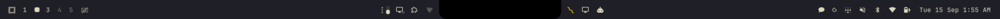

# Notch Bar

An Omarchy bar for Apple Silicon MacBooks with a camera notch. On the built-in display, the top bar splits into two islands around the notch: nothing is drawn or clickable behind the camera, and the islands' backgrounds follow the notch's rounded corners. On external monitors, at other bar positions, or with the split turned off, it is the stock Omarchy bar.



It is a fork of Omarchy's built-in bar (`omarchy.bar`), so every widget, panel, gesture, and `omarchy bar` command keeps working.

## Requirements

- Omarchy 4 on Asahi Linux, with the notch area enabled (Omarchy's installer sets `appledrm show_notch=1`)
- The bar at the top of the screen

## Install

```bash
omarchy plugin add https://github.com/crumble21/omarchy-notch-bar.git --enable
```

`--enable` makes it the active bar. The first time it loads, it adds its **Notch divider** to the center section of your layout.

To go back to the built-in bar: `omarchy bar use omarchy.bar` (or `omarchy plugin remove io.github.crumble21.notch-bar`).

## Placing widgets

```
[left …]      [center, before divider] ▐notch▌ [center, after divider]      [… right]
```

- `left` and `right` sections sit at the screen edges, as usual.
- The `center` section sits against the notch. Widgets before the Notch divider go on the left side of the notch; widgets after it go on the right.
- Drag widgets to rearrange them. Each island's notch-facing edge is a drop target, even when that side of the notch is empty.

## Config

Optional keys under `bar` in `~/.config/omarchy/shell.json`. All sizes are physical pixels. Restart the shell (`omarchy-restart-shell`) after changing them.

```json
"notch": { "split": true, "width": 348, "gap": 10, "bleed": 48 }
```

| Key | Default | Meaning |
|---|---|---|
| `split` | `true` | Split the bar around the notch |
| `width` | auto | Notch width. Set this if the islands overlap the notch or leave a gap |
| `gap` | about 10 | Space between each island's widgets area and the notch |
| `bleed` | `48` | How far each island's background reaches in under the notch, so it follows the notch's rounded corners. `0` stops the background at the gap |

Toggle the split without editing the file: `omarchy-shell omarchy.bar toggleNotchSplit`

## Supported panels

| Panel | Resolution | Notch width | Status |
|---|---|---|---|
| MacBook Pro 14" | 3024x1964 | 348 | Calibrated |
| MacBook Pro 16" | 3456x2234 | 348 | Estimate |
| MacBook Air 13.6" | 2560x1664 | 307 | Estimate |
| MacBook Air 15" | 2880x1864 | 307 | Estimate |

Any display scale works: sizes are converted from physical pixels. Other notched panels fall back to a width proportional to the panel.

**Help calibrate:** on an "Estimate" panel, set `"width"` in the config above and adjust it until the islands meet the notch edge (one pixel narrower and the background shows between the notch and the islands). Then [open an issue](https://github.com/crumble21/omarchy-notch-bar/issues) with your model, resolution, and value.

## Development

```bash
node test/notch-model-test.js   # geometry and layout tests
omarchy plugin validate .
```

- `NotchModel.js` holds the notch geometry and layout rules as pure functions.
- `NotchMarker.qml` is the zero-width divider widget.
- `Bar.qml` is Omarchy's bar with every change fenced by `// notch-split: begin` / `// notch-split: end`.

The running shell does not reload `Bar.qml` or `NotchModel.js` edits; run `omarchy-restart-shell`.

### Keeping up with Omarchy

`upstream-base/` holds the Omarchy bar this fork last synced from, and `UPSTREAM` records the version. After an Omarchy update:

```bash
./sync-upstream.sh              # 3-way merges upstream Bar.qml changes, refreshes BarModel.js
node test/notch-model-test.js
omarchy-restart-shell           # then check the bar
```

## License

MIT. `Bar.qml`, `BarModel.js`, and `upstream-base/` are derived from [Omarchy](https://github.com/basecamp/omarchy), copyright David Heinemeier Hansson.
